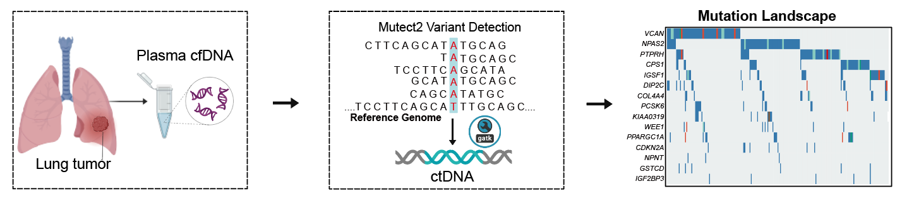
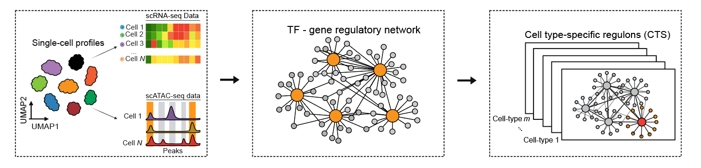
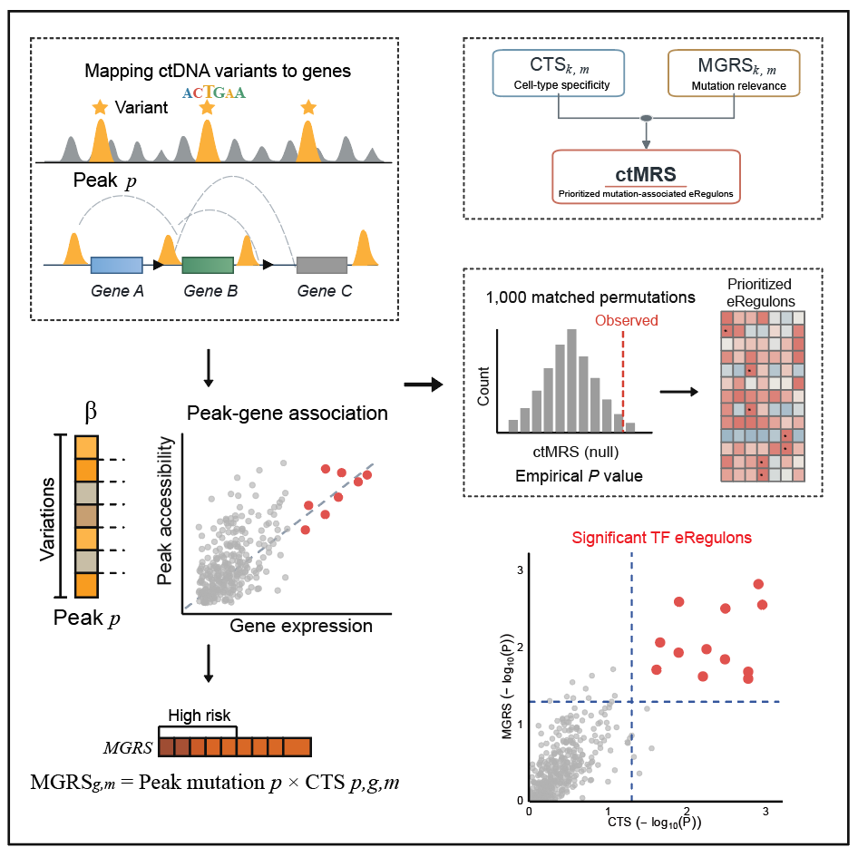

# ctMRS

`ctMRS` is an R package for integrating paired single-cell RNA/ATAC data,
transcription-factor motifs, and cohort somatic mutations. It builds a
full-genome TF-peak-gene regulatory network and calculates cell-type
specificity (CTS), mutation gene-regulatory scores (MGRS), and a combined
mutation regulatory score (MRS).

ctMRS assumes that recurrent plasma ctDNA mutations can be interpreted in
their cellular regulatory context by linking them to accessible chromatin
regions and TF-centered gene-regulatory programs. The framework first
characterizes the cohort-level ctDNA mutation landscape, then integrates
paired single-cell RNA-seq and ATAC-seq profiles with TF motif information to
construct a global TF-peak-gene network and resolve cell type-specific
eRegulons. Recurrent ctDNA variants are mapped to accessible regulatory peaks
and connected to candidate target genes through peak-gene associations.
Cell-type specificity (CTS) and mutation-associated gene-regulatory relevance
(MGRS) are subsequently integrated into the mutation-associated regulon score
(MRS). Matched Monte Carlo permutations are used to estimate empirical P
values and false-discovery rates and to prioritize significant
mutation-associated eRegulons.

The required inputs include paired single-cell RNA-seq and ATAC-seq data, TF
motif annotations, a GRCh38 gene annotation, and a cohort-level somatic
mutation table containing genomic coordinates and sample identifiers.

## Workflow

### Plasma ctDNA mutation profiling

Plasma cfDNA is analyzed with Mutect2 to identify somatic variants and
characterize the cohort-level ctDNA mutation landscape. Mutation relevance is
based on `log(1 + number of mutated samples)`. Functional annotations are
retained for description and are not assigned manual impact weights.

<p align="center">
  
</p>

### Cell type-specific regulatory network construction

Paired single-cell RNA-seq and ATAC-seq profiles are integrated with TF motif
annotations and peak-gene associations to construct a global TF-peak-gene
regulatory network. The global network is resolved into cell type-specific
TF-centered eRegulons and used to quantify cell-type specificity (CTS).

<p align="center">
  
</p>

### Mutation-associated regulon scoring and significance testing

Recurrent ctDNA variants are mapped to accessible chromatin peaks and linked
to candidate target genes. Mutation-associated gene-regulatory relevance
(MGRS) is integrated with CTS to calculate the final mutation-associated
regulon score (MRS). Matched Monte Carlo permutations generate empirical P
values and false-discovery rates for prioritizing significant
mutation-associated eRegulons.

<p align="center">
  
</p>

```text
RNA + ATAC + motif -> TF-peak-gene global GRN -> cell-type sub-GRNs -> CTS
somatic variants -> cohort recurrence -> mutated ATAC peaks -> MGRS
CTS + MGRS - discordance penalty -> MRS -> matched-control Monte Carlo P/FDR
```

## Installing ctMRS

We recommend installing ctMRS from GitHub using `remotes`:

```r
if (!requireNamespace("remotes", quietly = TRUE)) {
  install.packages("remotes")
}
remotes::install_github("CKNckn11/ctMRS")
library(ctMRS)
```

See the `DESCRIPTION` file for the complete list of R dependencies. If all
dependencies are already installed, package installation should finish within
a few minutes.

## Required inputs

- A single-cell RNA Seurat object or RDS file.
- A single-cell ATAC Signac/Seurat object or RDS file containing a peak assay
  and motif annotations.
- GRCh38 gene annotation as a `GRanges` object or RDS file.
- A tab-delimited somatic-mutation table containing genomic coordinates,
  alleles, functional annotations, and sample identifiers.

## How to run ctMRS

```r
#@' Main function
#@' rna: Seurat RNA object or path to an RNA RDS file
#@' atac: Seurat/Signac ATAC object or path to an ATAC RDS file with motifs
#@' gene_annotation: GRCh38 gene annotation as a GRanges object or RDS path
#@' mutations: ANNOVAR multianno mutation table or input file path
#@' output_dir: Directory used to save intermediate and final results
#@' rna_assay: RNA assay name, default set to "RNA"
#@' peak_assay: Chromatin-accessibility assay name, default set to "ATAC"
#@' celltype_column: Metadata column containing cell-type annotations
#@' variable_genes: Number of highly variable genes, default set to 5,000
#@' peak_gene_distance: Maximum peak-to-TSS distance, default set to 500 kb
#@' correlation_chunk_size: Number of peak-gene pairs processed per chunk
#@' min_peak_gene_cor: Minimum positive peak-gene correlation, default 0.05
#@' max_peak_gene_fdr: Maximum BH-adjusted peak-gene FDR, default 0.05
#@' min_targets_per_tf: Minimum target genes required per TF, default 5
#@' cell_edge_quantile: Within-eRegulon edge quantile retained, default 0.5
#@' mutation_peak_buffer: Peak extension used for mutation mapping, default 0 bp
#@' min_recurrent_samples: Minimum exact-variant recurrence, default 1 sample
#@' theta: Target-node contribution to CTS, default set to 0.5
#@' top_n: Number of strongest target-level MGRS values averaged, default 5
#@' perm_n: Number of matched Monte Carlo permutations, default 1,000
#@' seed: Random seed for reproducible permutation analysis, default 1,234
#@' control_pool_n: Maximum number of matched control eRegulons, default 50
#@' min_control_pool: Minimum size-matched control pool, default 20
#@' nominal_p: Nominal empirical MRS P-value threshold, default 0.05
#@' fdr_cutoff: Global MRS false-discovery-rate threshold, default 0.05

fit <- run_ctMRS(
  rna = "path/to/rna_object.rds",
  atac = "path/to/atac_object_with_motifs.rds",
  gene_annotation = "path/to/grch38_gene_annotation.rds",
  mutations = "path/to/somatic_mutations.tsv",
  output_dir = "path/to/ctMRS_results",
  rna_assay = "RNA",
  peak_assay = "ATAC",
  celltype_column = "celltype",
  variable_genes = 5000L,
  peak_gene_distance = 500000L,
  correlation_chunk_size = 2000L,
  min_peak_gene_cor = 0.05,
  max_peak_gene_fdr = 0.05,
  min_targets_per_tf = 5L,
  cell_edge_quantile = 0.5,
  mutation_peak_buffer = 0L,
  min_recurrent_samples = 1L,
  theta = 0.5,
  top_n = 5L,
  perm_n = 1000L,
  seed = 1234L,
  control_pool_n = 50L,
  min_control_pool = 20L,
  nominal_p = 0.05,
  fdr_cutoff = 0.05
)
```

Use `perm_n = 10000L` or more for a final analysis. The primary analysis can
retain `min_recurrent_samples = 1L`, because recurrence enters continuously
through `log1p(n_samples)`.

## Main functions

| Function | Description |
|---|---|
| `run_ctMRS()` | Runs the complete ctMRS workflow and returns intermediate and final results. |
| `prepare_ctMRS_inputs()` | Pairs RNA and ATAC cells, validates cell-type annotations, and extracts the required matrices. |
| `calculate_gene_cts()` | Calculates cell-type specificity scores for TFs and target genes. |
| `extract_tf_peak()` | Maps stored TF motif matches to accessible chromatin peaks. |
| `link_peaks_genes()` | Calculates full-genome associations between peak accessibility and gene expression. |
| `build_global_grn()` | Integrates TF-peak motif relationships with peak-gene associations to construct the global regulatory network. |
| `build_celltype_subgrn()` | Resolves the global network into cell type-specific regulatory edges. |
| `calculate_mutation_relevance()` | Maps recurrent somatic mutations to accessible peaks and calculates peak-level mutation relevance. |
| `calculate_target_mgrs()` | Calculates mutation-associated regulatory scores at the edge and target-gene levels. |
| `score_eregulons()` | Integrates CTS and MGRS to calculate the mutation-associated regulon score. |
| `test_eregulons_mc()` | Performs matched Monte Carlo testing and calculates empirical P values and FDR. |

## Related tools

1. [cfDNA Mutect2 Pipeline Generator](https://github.com/CKNckn11/cfDNA_Mutect2_generator)

   This companion tool generates configurable tumor-only cfDNA somatic variant
   calling workflows, including Mutect2 calling, contamination estimation,
   variant filtering, ANNOVAR annotation, and final mutation-table aggregation.
   The aggregated annotated mutation table can be used as the somatic-mutation
   input for ctMRS.

## Author

Kangnan Chen (`CKNckn11`)  
GitHub: https://github.com/CKNckn11

## License

MIT
